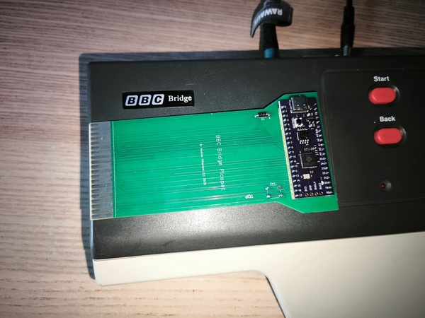
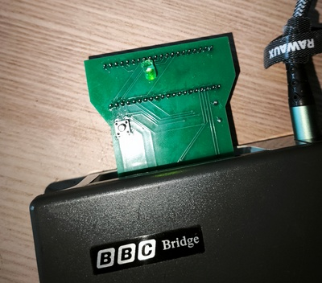
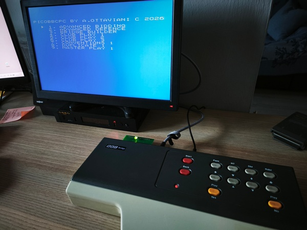
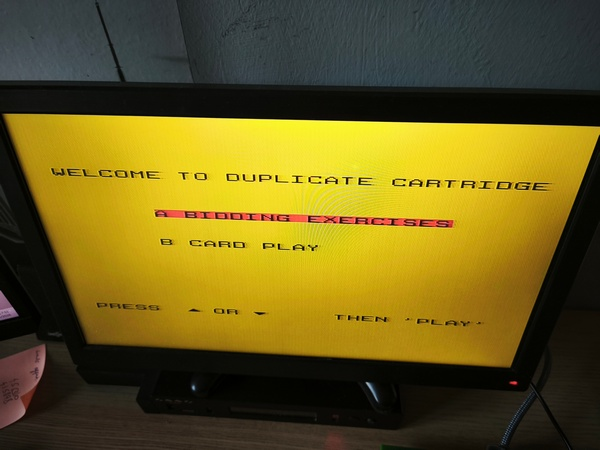
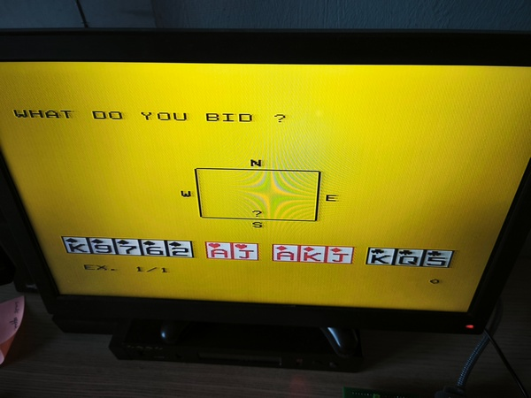
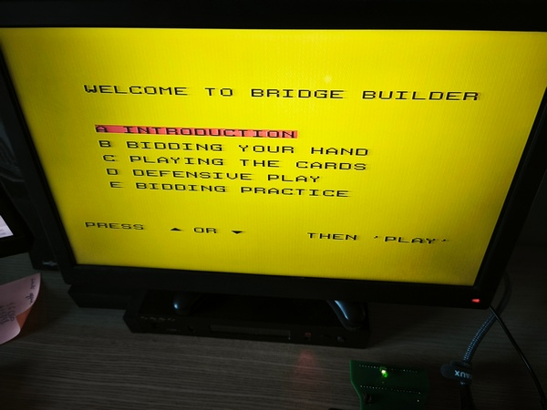

# PicoBBCBC
A BBC Bridge Companion Multicart based on Pico clone

This project allows you to bypass the original system constraints and load multiple ROMs onto the console using an interactive Z80 Assembly frontend menu and smart address-bus monitoring for seamless bank-switching.

---

## Hardware Gallery

Here is the hardware implementation of the multicart PCB and assembly:

| Cartridge PCB | Fully Assembled Unit |
|:---:|:---:|
|  |  |




*(Note: Please ensure your image filenames inside the `pictures/` folder match `pcb.jpg` and `assembled.jpg`, or update the paths above accordingly!)*

---

## How It Works

1. **The Z80 Frontend Menu**: Upon boot, a custom splash screen and menu written in pure Z80 Assembly initializes the TMS9129 VDP (Video Display Processor) and the Z80PIO chip.
2. **Menu Navigation**: The console's dedicated keyboard matrix is scanned continuously.
   * Press **PASS** to scroll **UP**.
   * Press **SPADES ** to scroll **DOWN**.
   * Press **CLUBS (** to **SELECT/START** the highlighted game.
3. **Address-Bus Triggering**: Once a game is selected, the cursor flashes as a confirmation feedback. The Z80 CPU then enters a tight loop, constantly reading from a specific ROM address range:
   \[\text{Target Address} = \$5000 + \text{Game Index (0-8)}\]
4. **Pico Bank-Switching**: The Raspberry Pi Pico acts as a bus sniffer. It detects the continuous read cycles (`MREQ` and `RD` active) on the targeted address within the `$7000–$7008` window. It instantly switches the memory bank to the selected game ROM and triggers a hardware reset to boot the new title.

---
## IMPORTANT NOTE: by mistake, I designed the edge connector REVERSED, so the cartridge *MUST* be inserted with pico facing down!


## Project Structure

The repository is organized as follows:
* `/PicoBBCBC`: Contains the `.ino` firmware source code for the Raspberry Pi Pico.
* `/PCB`: Contains the design files, schematics, and layouts for manufacturing the custom cartridge board.
* `/roms`: Storage directory for compiling and organizing the game binary files.
* `/pictures`: Images and visual documentation of the project.

---

## Compilation & Installation

### Z80 Menu Compilation
To assemble the menu source code (`splash.asm`), use the `gasm80` assembler:
```bash
gasm80 splash.asm -o splash.bin
```

### Pico Firmware
1. Open `PicoBBCBC.ino` in the Arduino IDE.
2. Install the **Raspberry Pi Pico/RP2040** board support package.
3. Ensure your file loading functions are designated with `const char*` signatures to match modern ISO C++ standards.
4. Compile and upload the code to your Pico clone.

---

## License
This project is licensed under the GPL-3.0 License - see the [LICENSE](LICENSE) file for details.

## Acknowledgments
* Special thanks to **Leaded Solder** for the extensive reverse engineering documentation on the BBC Bridge Companion VDP registers, Z80PIO matrix structures, and stack pointer layout.
